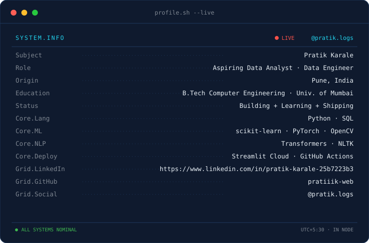
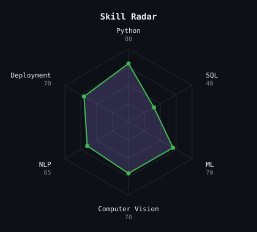
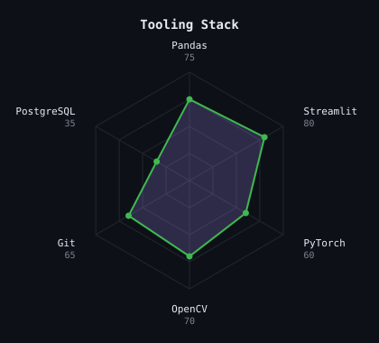
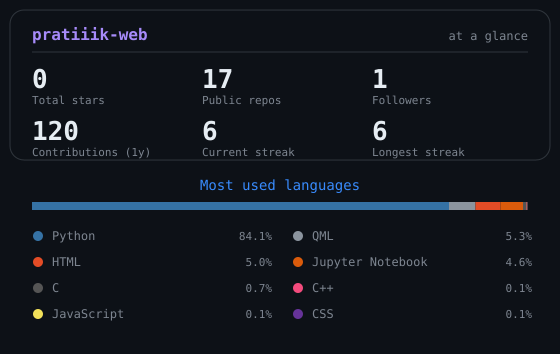

<table align="center"><tr>
<td></td>
<td></td>
</tr></table>

---

## This is me :)

Hi, I'm **Pratik**, a final-year Computer Engineering student from India. I'm heading into **data analyst / data engineer** roles first, with ML and data science as the long-term track.

- 🎓 B.Tech Computer Engineering, University of Mumbai
- 📊 Turning raw data into insights: SQL, Python and dashboards, with every project deployed
- 🤖 Deployed ML projects across tabular ML, computer vision and NLP (Streamlit)
- 🚗 Real-time driver monitoring (DriverGuard), crop disease detection, and more
- 💬 Ask me about ML projects, CV pipelines, or breaking into data roles

---

<h3 align="center">my stack</h3>

  

---

<h3 align="center">signals</h3>

  
  

---

<h3 align="center">numbers matter? ohhh yes.</h3>

  

Auto-refreshed every 12 hours by GitHub Actions · @pratiiik-web

